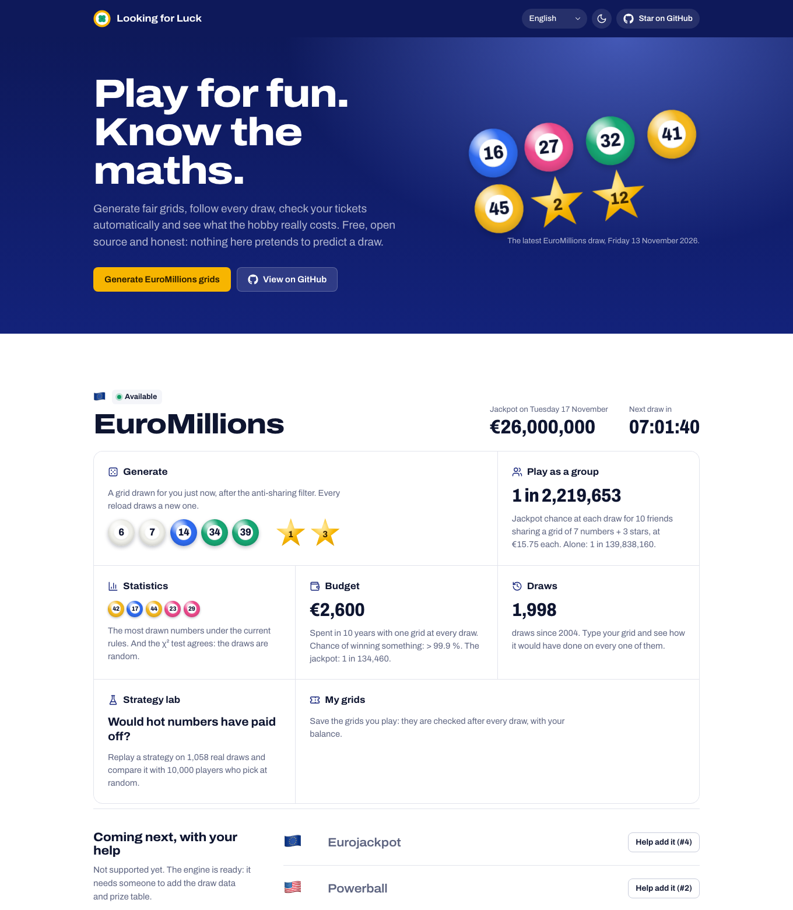
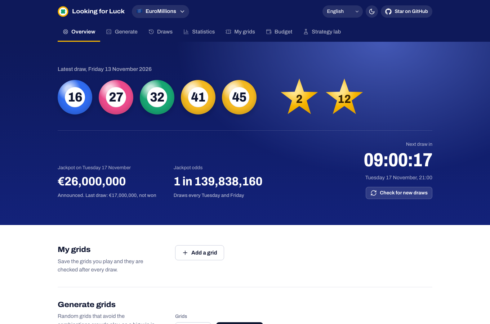
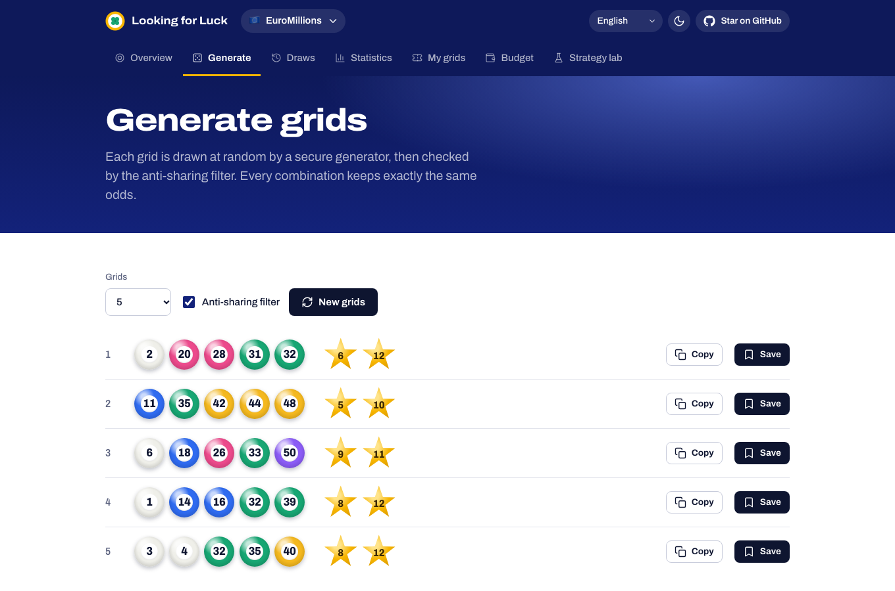
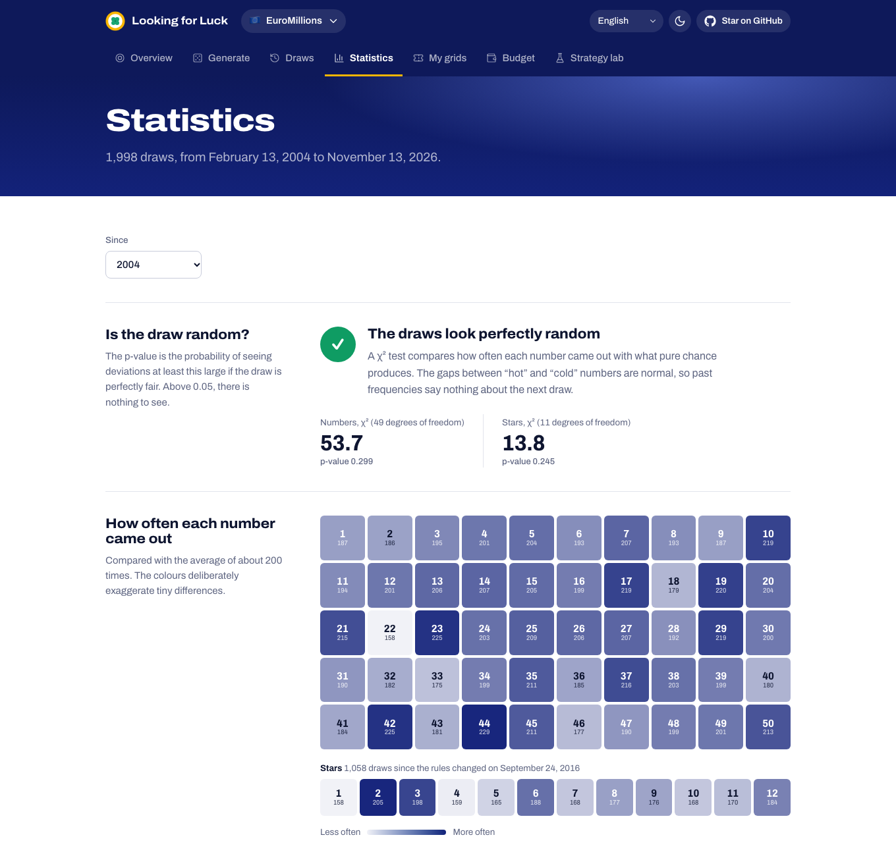
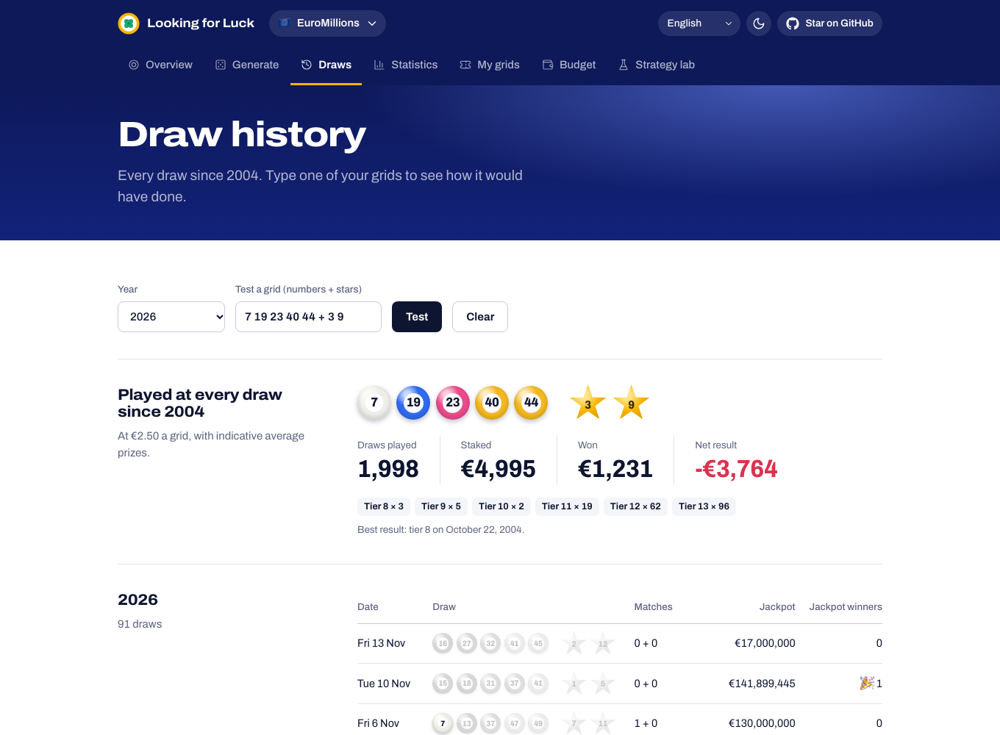
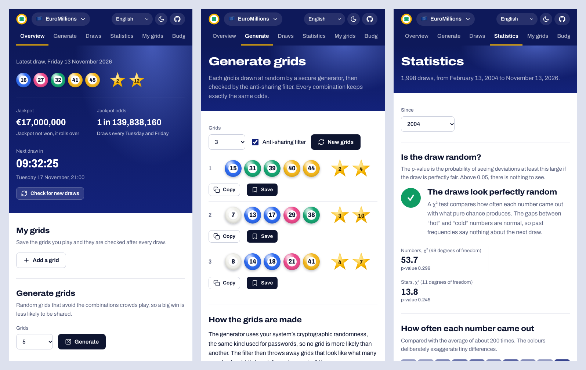

# 🍀 Looking for Luck

**The honest lottery toolkit.** Generate fair grids, follow every draw, check
your tickets automatically and see what the hobby really costs — in a web app
you run at home with one Docker command, or from the terminal.

[](https://github.com/beebop1032/looking-for-luck/actions/workflows/ci.yml)




> **The honest part:** nothing in this project improves your odds of winning.
> Every draw is independent, a ticket's expected value is negative, and our
> own χ² test confirms the draws are compatible with pure randomness. What it
> *does* do: generate grids you're less likely to **share** a jackpot with,
> show what any "hot numbers" strategy is really worth, and tell you what
> your hobby costs over ten years. Play for fun, never for profit.

## 🚀 Run it at home

```bash
git clone https://github.com/beebop1032/looking-for-luck.git
cd looking-for-luck
docker compose up -d
```

Open **<http://localhost:8090>**. That's it: one container serves the web
interface ([FrankenPHP](https://frankenphp.dev)) and runs a scheduler
([supercronic](https://github.com/aptible/supercronic)) that fetches every new
draw and checks your saved grids. Your data stays on your machine, in the
`lottery-data` volume.

- Another port: `LFL_PORT=9000 docker compose up -d`
- Audience measurement for your own deployment: `LFL_GA4_ID=G-XXXXXXX`
  (Google Analytics 4) or `LFL_GTM_ID=GTM-XXXXXXX` (Google Tag Manager), behind
  a consent banner: nothing is loaded before the visitor accepts. Unset,
  there is no tracking and no banner.
- The interface has no login: by default, everyone who opens it shares the
  same saved grids, which is right on your machine or home network. To put it
  on the internet, see [deploy/README.md](deploy/README.md): HTTPS on your
  domain, and each visitor's grids kept in their own browser
  (`LFL_GRIDS=browser`).

## ✨ What's inside

| | |
|---|---|
| **Overview** — the latest draw lands on the stage, ball by ball, with the jackpot announced for the next draw, the real odds and a live countdown. |  |
| **Generate** — grids drawn by a cryptographically secure generator, then passed through an **anti-sharing filter** that throws away what crowds play: birthdays (all ≤ 31), sequences, patterns on the paper slip, shared multiples, past winning combinations — and shows you the grids it threw away, and why. Your odds don't change; your expected share of a jackpot does. |  |
| **Statistics** — frequencies, longest absences and pairs over the **full history since 2004** or any exact date range, a heatmap, and a χ² test explained in plain language. (Spoiler: the draws are random.) |  |
| **Draws** — every draw since 2004, with jackpots and winners. Type one of your grids to replay it on two decades of draws: what doesn't match fades away. Light and dark themes. |  |

Also in the box:

- 🎟️ **My grids** — save the grids you play, simple or multiple (up to 10
  numbers and 12 stars); every combination they contain is checked after each
  draw, with every prize won and your indicative balance.
- 👥 **Play as a group** — friends share a multiple grid (7 numbers + 3
  stars = 63 combinations…): exact chances for the group at each draw and
  over the years, each person's share, and the honest answer — the group wins
  more often but shares every prize; each euro is worth exactly the same as
  when playing alone.
- 💸 **Budget** — what you spend per week, per year and over N years; your
  exact chances of winning each prize *at least once* over the whole period
  (and how many times on average); and what a typical player gets back,
  from 10,000 simulated lives — without the misleading "average" that the
  jackpot inflates.
- 🧪 **Strategy lab** — replay *hot*, *cold*, *overdue* or *random* picks on
  the whole history (using only what was known before each draw) against
  10,000 random players, and see where the strategy really lands.
- 🌍 **Five languages** — 🇬🇧 English, 🇫🇷 French, 🇳🇱 Dutch, 🇪🇸 Spanish and
  🇩🇪 German, in the web interface (it follows your browser and remembers your
  choice) and in the terminal (`--locale=fr`).
- 📱 **Works on your phone.**



## 🎰 Lotteries

The engine knows nothing about any particular lottery: a lottery is a matrix
(numbers + bonus numbers), a prize table, a draw schedule and a draw source.
Add one, and every page of the web interface, the scheduled sync and the
statistics work for it with no other code.

| Lottery | Status |
|---|---|
| 🇪🇺 EuroMillions | ✅ Supported |
| 🇪🇺 Eurojackpot | 🙋 Looking for a contributor — [#4](https://github.com/beebop1032/looking-for-luck/issues/4) |
| 🇺🇸 Powerball | 🙋 Looking for a contributor — [#2](https://github.com/beebop1032/looking-for-luck/issues/2) |
| 🇺🇸 Mega Millions | 🙋 Looking for a contributor — [#3](https://github.com/beebop1032/looking-for-luck/issues/3) |
| 🇬🇧 UK Lotto, 🇫🇷 Loto, 🇧🇪 Lotto… | Open to pull requests |

Lotteries waiting for a contributor are listed in the interface too, with a
link to their issue. **[CONTRIBUTING.md](CONTRIBUTING.md) walks you through
adding one** — it is mostly data, and the tests tell you when the odds are
right.

## ⌨️ Command line

Everything also works in the terminal, with colourful output (lottery balls,
bars, heatmaps):

```bash
composer install                                   # or prefix with: docker compose run --rm app

bin/console app:euromillions:predict 5             # 5 grids, anti-sharing filter on
bin/console app:euromillions:stats                 # full-history statistics + χ² test
bin/console app:euromillions:lab hot               # backtest "hot numbers" vs 10,000 players
bin/console app:euromillions:budget --years=10     # what does 10 years of playing cost?
bin/console app:euromillions:grids add "1 9 23 34 48 + 3 7"
bin/console app:euromillions:grids check
bin/console app:sync                               # fetch new draws + check grids, all lotteries

php -S 127.0.0.1:8000 -t public                    # the web interface, without Docker
```

**In your language:** add `--locale=fr` (or `nl`, `es`, `de`) to any command,
or set `LFL_LOCALE=fr` (`LC_ALL` and `LC_MESSAGES` work too). Amounts and
dates follow the language. Output stays in English unless you ask: `LANG`
alone does not switch it.

```bash
bin/console app:euromillions:budget --years=10 --locale=fr
LFL_LOCALE=de docker compose run --rm app app:euromillions:stats
```

**Optional AI assistant:** put an Anthropic API key in `.env.local` and chat
with Claude about *your* data with `bin/console app:euromillions:ask`. It gets
a factual summary (statistics, χ² verdict, prize maths, your grids) and
kindly refuses to "predict" anything. Everything else works without it.

## 🧱 How it's built

Symfony 8 and Twig, no JavaScript build step, no database: draws and grids are
small JSON files, revalidated every time they are read.

The design ("draw night") borrows from televised lottery draws: a dark blue
stage where the balls land, and a calm page below it. Colour belongs to the
balls — coloured by tens, with the white centre disc of real lottery balls —
and everything else is ink, paper and rules. One self-hosted typeface,
[Archivo](https://fonts.google.com/specimen/Archivo), used across its width
axis. The whole design system is one hand-written stylesheet.

```
src/
├── Lottery/                    # the engine — knows no specific lottery
│   ├── LotteryGame.php          # a matrix: pools, picks, prize tiers, schedule, currency
│   ├── DrawSource.php           # where a lottery's draws come from
│   ├── LotteryDefinition.php    # registers a lottery with the web app and the sync
│   ├── LotteryRegistry.php      # every registered lottery (+ the roadmap)
│   ├── Lottery.php              # one lottery with its engine wired to its own data
│   ├── GridGenerator.php        # cryptographically secure sampling (random_int)
│   ├── PopularityFilter.php     # the anti-sharing rules
│   ├── PrizeTable.php           # exact hypergeometric odds per tier
│   ├── Statistics.php, ChiSquare.php
│   ├── StrategyLab.php, BudgetSimulator.php, WinSampler.php
│   ├── GridStore.php, GridInput.php, Synchronizer.php, DrawSchedule.php
│   └── Grid.php, Draw.php, PrizeTier.php, …
├── Euromillions/               # the EuroMillions adapter: game, CSV draw source, definition
├── Command/                    # console commands + Ui (balls, bars, colours)
├── Controller/                 # thin web controllers, one URL space per lottery: /euromillions/…
└── Web/                        # Twig helpers, language detection
templates/                      # Twig templates
translations/                   # web (messages+intl-icu.*) and terminal (cli+intl-icu.*) strings, per language
public/css/app.css              # the whole design system, hand-written
```

Data lives in `var/<lottery>/` (or `$LFL_DATA_ROOT/<lottery>/`). The draw
history is downloaded once (one CSV per year), refreshed only when a draw is
due, and falls back to the cache when offline; an empty or unparseable answer
never overwrites a good cache.

## ✅ Quality

```bash
vendor/bin/phpunit            # unit + web tests (every page, every language)
vendor/bin/phpstan analyse    # static analysis, level max
vendor/bin/php-cs-fixer fix   # coding standards (@Symfony + risky)
```

CI runs the tests on PHP 8.4 and 8.5, PHPStan at level **max**,
php-cs-fixer, `composer audit`, and builds the Docker image and checks that
the web interface answers. The tests cover the χ² quantiles, the official
odds (to the digit), the sum of all outcome probabilities (= 1), every filter
rule, the draw schedule, the CSV parser, every page in all five languages, and
that every language defines every string.

## 🔒 Security

- `composer audit` clean in CI; HTTP through Symfony's HttpClient (TLS
  verified, timeouts, capped redirects, a single hard-coded host).
- Every piece of external data (downloaded CSV, JSON caches, grid files) is
  validated before use; all writes are atomic.
- Web forms are CSRF-protected; the container runs as an unprivileged user.
- Real grids come from `random_int()`; simulations use a fast PRNG, clearly
  separated.

## 🤝 Contributing

Issues and pull requests are welcome — especially **new lotteries**, better
prize data, **translations** and design feedback. Start with
[CONTRIBUTING.md](CONTRIBUTING.md). One rule above all: the maths stays
honest, and every screen that touches money keeps its reality check.

## ⚠️ Responsible play

Gambling involves risk: debt, isolation, addiction. If playing stops being
fun, help exists — among others: [BeGambleAware](https://www.begambleaware.org) (UK),
[Joueurs Info Service](https://www.joueurs-info-service.fr) (FR),
[SOS Jeux](https://www.joueurssosjeux.be) (BE), [NCPG](https://www.ncpgambling.org) (US).

Every page and every command shows an **18+ warning**. Where a country
prescribes the wording it is quoted verbatim: France (arrêté du 4 mars 2026)
and Belgium (arrêté royal du 27 février 2023, French and Dutch). Elsewhere a
plain warning in your language is shown. The country comes from your browser
language (`fr-BE`, `fr-FR`…) or locale (`LC_ALL=fr_BE.UTF-8`); force it with
`LFL_COUNTRY=be`. Wordings live in `src/Web/GamblingNotice.php`: if your
country requires one, a pull request with the official source is welcome.

## 📄 License

[MIT](LICENSE). The Archivo font is under the
[SIL Open Font License](public/fonts/OFL.txt).
